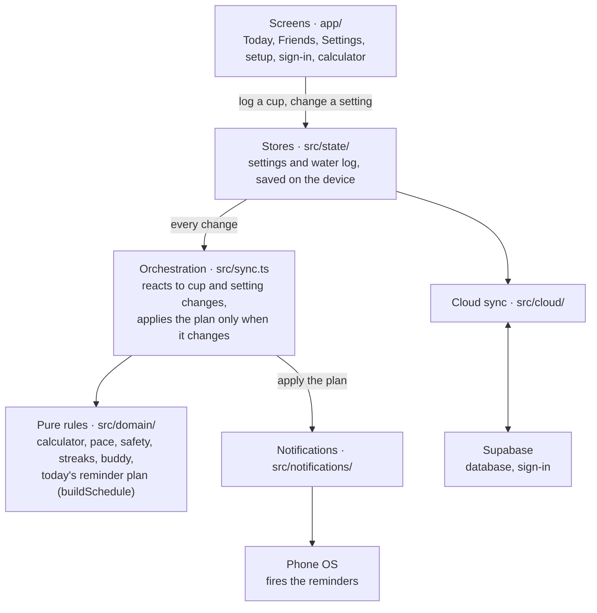

# Flow State: Complete Overview

Last updated: 2026-11-17 (version 3.2.0). A shareable, commentable copy of this overview lives in Claude Docs; this file keeps it with the code.

## Part 1 — The product

### Summary

Flow State (full name "Stanford Flow State") is a free water-reminder and hydration-tracking app for Stanford students, built by the Health & Wellness group of SENSA Impact Labs, a Stanford student organization. Version 3.2.0 runs on iPhone, Android and the web from one codebase. It sends gentle reminders during the hours a student chooses, tracks cups toward a personalized daily goal, nudges students who fall behind, warns those drinking too much too fast, and lets friends cheer each other on.

The app works fully offline with no account. An optional sign-in with a @stanford.edu email backs up the water log and unlocks friends. Reminder settings and calculator answers never leave the phone.

### The problem and who it's for

Students go from class to library to practice and simply forget to drink water, which hurts focus, mood and energy. Most hydration apps are generic, noisy, ad-driven or collect more data than they need. Flow State is made for Stanford students specifically: Stanford sign-in, Stanford colors, a friends feature for dorms and teams, and a SENSA-run anonymous impact measure so the student organization can show whether it helps.

### Design principles

- **Gentle, not nagging.** One short, consistent reminder ("Take a Drink of Water💧"), every hour by default, only during waking hours, with snooze, pause and "stop after my goal".
- **Personal.** The starting goal comes from a short water calculator (weight, sex, exercise, heat, pregnancy), and students can adjust it any time.
- **Aware of the day.** Progress is judged against the time of day, not just the total: being at 3 of 8 cups at 10 AM is fine, at 6 PM it's behind.
- **Safe.** Drinking too much is flagged too, with a break suggestion. Everything health-related is labeled as general guidance, not medical advice.
- **Private by default.** Offline-first; the minimum is uploaded only when a student signs in; friends see only a name, today's cups and a streak.
- **Accessible and on-brand.** Light and dark mode, contrast-tested colors (WCAG AA), Stanford Cardinal for actions and teal for water, official brand assets only.

### A student's journey

1. **First open.** A short setup: welcome, "About you" (the calculator, required), the suggested daily goal (adjustable), reminder interval and waking hours, whether reminders stop after the goal, then the notification permission.
2. **During the day.** A notification "Take a Drink of Water💧" arrives at the chosen interval. Long-pressing it offers "I drank a cup 💧" and "Snooze 1 hr"; or the student taps **+1 cup** in the app.
3. **The Today screen.** A ring fills toward the goal and changes color with pace (green on track, yellow a bit off, red far off), while a water-droplet buddy fills up and changes mood.
4. **Falling behind.** Halfway and three-quarters through their waking hours, a student who is behind gets "Time to catch up on water 🌊". Students on pace never see it.
5. **Overdoing it.** Four or more cups within an hour, or twice their daily need, brings a "take a break" alert and pauses reminders.
6. **Goal reached.** Reminders keep going or stop until tomorrow, as the student chose. The streak grows.
7. **Friends (optional).** Signing in with a Stanford email backs everything up and lets friends add each other by code, email, invite link or QR, then see each other's cups today and streaks.

## Part 2 — Features in detail

### Onboarding

Setup takes about a minute and the calculator is required, so every student starts with a personal goal. Continue stays disabled on "About you" until a valid weight is entered.

| Step | Phone apps | Website |
| --- | --- | --- |
| Welcome | Yes | Yes, plus the "apps coming soon" banner |
| About you (water calculator) | Required | Required |
| Your daily goal | Prefilled from the calculator, adjustable 1–20 cups | Same |
| Your reminders | Interval wheel + waking hours | Skipped |
| After you reach your goal | Keep reminding / Stop until tomorrow | Skipped |
| Turn on reminders | Notification permission prompt | Skipped |

Students who set up an older version see a one-time "Personalize your goal" card on Today that runs the same calculator; they can also dismiss it. Going Back and Continue in setup keeps any manual goal adjustment unless the calculator answers change.

### Water calculator

The calculator gives a population-level estimate, not medical advice; every number lives at the top of `src/domain/waterCalculator.ts` for the health team to review.

1. Weight-based estimate: 33 mL per kg of body weight (midpoint of the common 30–35 mL/kg).
2. Guideline for water from drinks (about 80% of the US National Academies' Adequate Intake): 3.0 L for men, 2.2 L for women, 2.6 L if sex isn't given.
3. Base = the average of 1 and 2.
4. Additions: +355 mL (12 oz) per 30 minutes of daily exercise; +2 cups for hot weather; +1 cup if pregnant; +3 cups if breastfeeding.
5. Rounded to whole 8-oz cups and kept between 4 and 20 cups.

Weights from 30–250 kg (66–550 lb) are accepted, in pounds or kilograms; exercise goes up to 300 minutes. Answers are saved on the phone only, so the form is prefilled next time, and are never uploaded. Settings → Goal → "Update my details in the calculator" reruns it with a full breakdown and a "Set as my daily goal" button.

### The Today screen

Today shows one ring, one buddy and one big button.

- **Progress ring** fills toward the goal. Its color reflects pace for the time of day:

| Color | When |
| --- | --- |
| Green | On track for this time of day, or goal met without overdoing it |
| Yellow | A bit behind, or past 1.5× daily need |
| Red | Far behind, or a drinking-too-much warning |

- **Pace rule.** Expected cups by now = goal × the share of today's waking hours that has passed. On track = at least 75% of expected, or less than 1 cup short. Far behind = under 40% of expected and at least 2 cups short. Anything between is "a bit behind". Before waking hours start, everyone is on track.
- **Status line** under the count explains the color: "On track for this time of day ✓", "A bit behind. Have a cup when you can.", "Far behind for this time of day. Time to catch up!", or "That's plenty. Take a break." A banner explains drinking-too-much warnings.
- **Water buddy**: a droplet character that fills with water and changes mood: thirsty (0 cups), okay (under half), happy (half or more, "One more cup to go!" at goal − 1), thrilled with sparkles (goal reached; "Goal smashed!" past it), and overfull with dizzy eyes during a warning.
- **+1 cup** (8 oz, with a haptic tap on phones) and **Undo last cup**.
- **Streaks**: the current streak (days in a row the goal was met; today counts once met, otherwise the streak runs through yesterday) and the best streak. Each day keeps the goal it had, so changing the goal never rewrites history.
- **7-day chart** of cups per day against that day's goal.
- **Friends card** with friends' cups today (when signed in), the Personalize card (older users), and on the website the "coming soon" banner and a "Reminders live on your phone" card.

### Reminders

Every reminder is the same simple notification: **"Take a Drink of Water💧"**, no body text.

| Setting | Options | Default |
| --- | --- | --- |
| Interval | Scroll wheel (iOS) or picker (Android), 15 min to 3 h in 15-min steps | 1 hour |
| Waking hours | Start and end time; may cross midnight | 9:00 AM – 9:00 PM |
| After the goal | Keep reminding me / Stop until tomorrow | Keep |
| Smart check-ins | On / off | On |
| Reminders | Master switch | On |
| Pause | 1 hour, 2 hours, rest of today; Resume | — |

- **Action buttons** on the notification (long-press or swipe): "I drank a cup 💧" logs a cup without opening the app; "Snooze 1 hr" pauses for an hour. They need a development or store build; Expo Go may not show them.
- **Test reminder**: Settings → "Send a test reminder" fires one about 10 seconds later.
- **Status card** on Today/Settings shows the next reminder time, a paused state, or a prompt to allow notifications (with a button to the phone's Settings).
- The website can't schedule reminders; it offers a test notification instead (see The website).

### Catch-up check-ins

Check-ins are extra notifications that only reach students who are behind. They're scheduled at 50% and 75% of the waking hours, rounded to 15 minutes (3:00 PM and 6:00 PM for 9 AM–9 PM). The first says "Time to catch up on water 🌊" with "You're a bit behind for today. Try to catch up with a cup or two."; the second "Water check-in".

Today's check-in is skipped when its time has passed, the goal is already met, reminders are quiet at that time (paused, goal-met with stop, or a safety break), or the cups already logged would be on pace at that time. Logging a cup reschedules, so catching up cancels it. Settings → Smart check-ins turns them off.

### Hydration safety (drinking too much)

Daily need = the larger of the goal and the calculator estimate, so lowering the goal never triggers false alarms. Thresholds sit in `SAFETY` in `src/domain/hydrationSafety.ts` as defaults for the health team.

| Level | Trigger | What happens |
| --- | --- | --- |
| Caution | Today's cups ≥ 1.5× daily need | Yellow ring, "Well past your goal. Ease off for now." |
| Warning (total) | ≥ 2× daily need | Red ring, overfull buddy, banner, one alert/notification "You've had plenty today"; reminders quiet until tomorrow's waking hours |
| Warning (fast) | 4+ cups within 60 minutes | Red ring, overfull buddy, banner, one alert/notification "Take a break from water 🫧"; reminders quiet for an hour after the last cup |

Each warning fires at most once per day per rule. In the app it's an alert; if the app isn't in front, an immediate notification; on the website, a browser alert. The copy says to drink only when thirsty and to see a clinician if unwell; it is not medical advice.

### Accounts and backup (optional)

Accounts are optional: everything except backup and friends works without one. Only @stanford.edu addresses can sign up, and the database itself enforces that, not just the app.

1. **Sign in** (Settings → Account, or from Friends): enter a Stanford email or just the SUNet ID ("@stanford.edu" is added). "Email me a code" sends a 6-digit code; there are no passwords and no links. iPhones can autofill the code.
2. **Enter the code.** A new code can be requested after 60 seconds; "Use a different email" goes back. Wrong or expired codes say so.
3. **Your name**: a first name or nickname (1–30 characters) that friends will see. It can be skipped and changed later. Then sign-in closes and returns to the screen that opened it.
4. **Backed up**: the water log and daily goal sync in the background; the Account card shows "☁️ Backed up …" and a "Sync now" link.
5. **Sign out** keeps the log on the phone. **Delete account** permanently deletes the account and the backed-up log from the server (the log on the phone stays).

If a phone holds another account's log, signing in asks before replacing it. Errors are plain: "Only @stanford.edu email addresses can sign up", "Too many attempts. Please wait a minute", "We couldn't send the email right now", "No internet connection".

### Friends

Friends lets students cheer each other on while sharing as little as possible: a display name, today's cups versus goal, and the current streak.

- **Your friend code**: 8 characters without look-alikes (no I, L, O, 0 or 1), shown as K7MN-P2Q9.
- **Ways to add someone**: their friend code; their exact Stanford email (only if they allow "Let friends find me by email"); an invite link via the share sheet; or the **"Scan to add me" QR code** on the Add friends screen.
- **Invite links**: on the web, `https://<site>/?add=CODE`; in the app, `flowstate://add-friend/CODE`. Scanning or opening one goes straight to Add friends with the code filled in, even for a visitor who hasn't set up the app; after sign-in they come right back to send the request.
- **Requests**: incoming requests show the sender's name and Stanford email so you know who it is; accept or decline. If both people request each other, they become friends at once. A student can have up to 50 pending outgoing requests.
- **Privacy**: "Not found" looks the same whether no such person exists, they turned email search off, or they blocked you. Students can remove or block anyone, and a block is never revealed.
- **The Friends tab** lists friends with a mini ring (✓ when they met their goal), cups today and a 🔥 streak. While open it refreshes every 15 seconds (on the website there's also a Refresh link; on phones, pull to refresh). Today also shows a compact Friends card.
- **A name is required** before adding friends, so requests always say who they're from.

All friendship rules live in database functions; the app can't write the friendships table directly.

### The website

The website is the same app in a browser, a companion to the phone apps for laptops and for the demo.

- **Has**: logging cups, the ring, buddy, streaks and chart, the calculator, sign-in, sync and friends (including the QR).
- **Doesn't have**: scheduled reminders. Browsers can't wake a closed page, so the reminder settings are replaced by a "Reminders live on your phone" card.
- **"Apps coming soon" banner** on Today and the welcome step: "Flow State for iPhone and Android is coming soon…". It disappears automatically once store links are set.
- **Test notification** (Settings): "Send a test notification" shows "Take a Drink of Water💧" five seconds later, exactly like the phone reminder. It works in Chrome, Safari, Firefox and Edge on computers and in Chrome on Android; the browser asks for permission first. iPhone Safari only allows website notifications for sites added to the Home Screen, so on iPhone the button explains that instead.
- Data stays in that browser's storage until the student signs in; then it syncs like a phone.

### Appearance, accessibility and brand

- **Light and dark mode**: follows the device by default; Settings → Appearance can force Light or Dark.
- **Colors with a job**: Stanford Cardinal Red (#8C1515) for actions and the brand; a lighter Cardinal-family red in dark mode so it stays visible; Stanford-teal water blue for water visuals; green/amber/red only for pace and safety.
- **Accessibility**: every text/background pairing and every graphic color is checked automatically against WCAG AA (4.5:1 for text, 3:1 for large text and graphics) in both themes; QR codes stay black on white in both themes so cameras can read them.
- **Brand rules** (Flow State is approved by Stanford Trademarks under SENSA): only official Stanford Block S artwork, never redrawn, recolored, stretched or combined with another logo; never the Stanford seal; no Stanford logo in the app icon; SENSA's logo shown separately; the app clearly names itself a SENSA student-organization project (launch screen and Settings → About).
- **Emojis are kept to purpose**: 💧 for water, 🔥 for streaks, ☁️ on the backup status line, and 🌊 / 🫧 on the check-in and take-a-break notifications.

## Part 3 — Privacy and safety

Flow State collects the least it can: with no account, nothing personal leaves the phone. The full policy is the draft in `PRIVACY.md` (placeholders for host region, email provider, retention and contact still to be filled before launch).

### Where each kind of data lives

| Data | Where it lives | Uploaded? |
| --- | --- | --- |
| Reminder settings (interval, waking hours, pause, after-goal, check-ins) | Phone only | Never |
| Calculator answers (weight, sex, exercise, heat, pregnancy) | Phone only | Never |
| Water log, daily goal, per-day goals | Phone (or browser) | Only when signed in, for backup and friends |
| Stanford email | Supabase sign-in system | When signing in |
| Display name, time zone, friend code, friendships, blocks | Supabase | When signed in |
| Anonymous daily summary (date, cups, goal, goal met, app version, platform) + a random install ID | Supabase, not linked to any account | Daily, unless turned off |
| Light/dark choice | Phone or browser | Never |

Notifications are scheduled by the phone itself; no server sends them. On the website, data sits in that browser's local storage until sign-in.

### What friends see

Friends see only a display name, today's cups versus goal, and the current streak. Never history, weight, calculator answers or email. A friend request shows the sender's name and Stanford email so the recipient knows who it is. Students can turn off "Let friends find me by email", remove or block anyone, and a block is never revealed ("not found" looks the same).

### Anonymous impact statistics

SENSA uses these to measure whether Flow State helps, for example average cups per day this week. Once a day (looking back up to 7 days), the app sends one row per day with water logged: date, cups, goal, whether it was met, app version, and platform, tagged with a random ID created on the device.

They are designed to be unlinkable: sent through a separate anonymous connection that never carries the account login, only the fields above, and only while Settings → Privacy → "Share anonymous usage stats" is on (on by default, explained during setup). The database accepts them only through one function that checks every value, and nobody can read the raw table through the app or API; the team views weekly and daily aggregates in the Supabase dashboard. Because they aren't linked to anyone, sent summaries can't be found or deleted per person.

### Deleting data

- **Delete account** (Settings → Account) removes the account, email, name, backed-up log, goals, friend code and friendships from the database. The log on the phone stays until the app is deleted.
- **Sign out** stops backup from that phone and deletes nothing.
- **Deleting the app** (or clearing browser data on the website) removes everything stored locally.

### Health and safety

Flow State is a wellness tool, not a medical service. The calculator gives a general estimate; the pace colors, check-ins and take-a-break warnings are gentle defaults chosen for the health team to review (all in `src/domain/`). The app says so wherever it gives guidance and points people with conditions that limit fluids (such as kidney or heart conditions) to a clinician. It is intended for Stanford students and is not directed at children under 13.

## Part 4 — Technical deep dive

### Tech stack

| Layer | Choice |
| --- | --- |
| App framework | Expo SDK 58, React Native 0.88, React 19.3, TypeScript |
| Navigation | Expo Router (file-based routes in `app/`) |
| State and storage | zustand stores persisted to AsyncStorage (localStorage on the web) |
| Notifications | expo-notifications, local only (no push server); expo-background-task for best-effort re-sync |
| Graphics | react-native-svg (ring, buddy, QR, logos); qrcode-generator for QR codes |
| Backend (optional) | Supabase: Postgres with row-level security, email one-time-code sign-in |
| Website | The same app via react-native-web, exported as a static single-page site; a tiny service worker for the test notification |
| Tests | Jest (215 unit tests, run in the America/Los_Angeles time zone) and `node --test` with PGlite, an in-process Postgres (43 database tests) |

### Repository map

| Path | What it holds |
| --- | --- |
| `app/` | Screens (Expo Router): `(tabs)/` Today, Friends, Settings; `onboarding.tsx`; `calculator.tsx` and `personalize.tsx` modals; `auth/` sign-in, code, name; `friends/add.tsx`; `add-friend/[code].tsx` invite links; `_layout.tsx` root startup |
| `src/domain/` | Pure logic, no I/O: water calculator, pace, hydration safety, today's assessment, streaks, buddy, impact summaries, local-time helpers |
| `src/scheduling/buildSchedule.ts` | Pure reminder planner: settings + time + today's state → the list of notifications to schedule |
| `src/sync.ts` | Orchestration: builds the plan, applies it when it changed, reacts to setting and cup changes, handles notification buttons |
| `src/notifications/` | OS adapter (expo-notifications calls), message text, the website test notification |
| `src/hydrationWatch.ts` | Watches the log and fires each take-a-break warning once a day |
| `src/state/` | Settings store, log store, notification permission, hydration (store loading), today helper |
| `src/cloud/` | Supabase clients, account and sign-in, sync and merge, friends, friend codes and invite links, anonymous impact stats |
| `src/ui/` | Theme and contrast-tested palette, shared components, ring, water buddy, QR, interval wheel, forms, cards, launch screen, brand assets |
| `supabase/migrations/` | Three SQL files: accounts and sync, friends, impact stats |
| `supabase/tests/` | Database tests for the security and friendship rules |
| `public/` | Website-only files: service worker, notification icon, Netlify rewrite |
| `docs/` | Backend setup, Android, website deploy, release checklist, demo day, this overview |
| `scripts/render-icons.mjs` | Regenerates app icons from the artwork |

### Architecture

The app is layered so that every rule is a pure, tested function and only thin edges touch the phone or network. Screens read stores; stores feed pure domain functions; `src/sync.ts` turns their output into OS notifications through one adapter; `src/cloud/` mirrors the log to Supabase in the background. The phone's copy of the data is always what the app shows, so the app works offline and is never blocked on the network.

Only two edges talk to the outside: the notifications adapter to the phone and cloud sync to Supabase, both in the background.

### The reminder engine

Phones won't let an app run code at each reminder time, and iOS allows at most 64 pending local notifications. Flow State therefore plans ahead and keeps the plan current:

- **Each reminder time is a daily repeating notification.** For 9 AM–9 PM every hour, that's 13 daily triggers, which the phone fires every day even if the app is never opened again.
- **Budget**: at most 58 daily reminder times (`MAX_DAILY_SLOTS`), plus 2 check-ins and 1 test reminder, under iOS's 64. At a 15-minute interval this caps waking hours at 14 h 15 min, and the app explains when it shortens a window.
- **Skipping just today**: when a time must not fire today (paused, goal met with "stop", a take-a-break period), that one time becomes a one-off notification at its next allowed occurrence; all other times stay daily. When the app next runs, everything returns to daily triggers. If the app is never reopened, only the skipped times are affected.
- **Quiet time** = the latest of: a manual pause; goal met with "Stop until tomorrow" (until tomorrow's waking hours); a daily-total warning (until tomorrow); a fast-drinking warning (an hour after the last cup).
- **Check-ins** use the same mechanism: a daily trigger, skipped today with a one-off for tomorrow when the student is on pace at that time, already met the goal, or it's quiet then.
- **Rescheduling** happens at launch, on returning to the app, after any reminder-related setting changes, whenever today's cups change (logging, undo, a notification button, a sync from another phone), and in a best-effort background task. The plan is compared with what's scheduled and only re-applied when different.

All of this is one pure function, `buildSchedule`, covered by 39 tests including daylight-saving changes.

### Data model

**On the device** (zustand, persisted):

| Store | Key | Holds |
| --- | --- | --- |
| Settings | `flow-state/settings` (version 1) | Onboarded, goal and when it changed, interval, waking hours, reminders on/off, pause, after-goal, check-ins, calculator answers, appearance, impact-stats switch, install ID and last day reported, warnings already shown today, Personalize dismissed |
| Log | `flow-state/log` (version 2) | Drink entries (id, time, cups, updatedAt, deletedAt), goal per day and when each changed, which entries/goals still need uploading, sync cursors, the account the data belongs to, last sync time |

Undo marks an entry deleted rather than erasing it, so the removal syncs to other phones.

**In Supabase** (every table has row-level security):

| Table | Columns (main) | Who can access |
| --- | --- | --- |
| `profiles` | id, display_name (1–30 chars), daily_goal (1–20), goal updated time, timezone, friend_code, discoverable_by_email | Own row only; friends' details only through `get_friends` |
| `drink_entries` | id, user_id, logged_at, local_date, cups (1–10), updated_at, deleted_at, synced_at | Own rows only |
| `daily_goals` | user_id, local_date, goal (1–20), updated_at, synced_at | Own rows only |
| `friendships` | requester, addressee, status (pending/accepted/blocked), blocked_by, timestamps | Read own (never "you were blocked"); no direct writes |
| `usage_daily` | install_id, local_date, cups, goal, goal_met, app_version, platform | No API access; written only by `report_usage` |

**Database functions**: `enforce_stanford_email` (rejects non-Stanford sign-ups), `handle_new_user` (creates the profile and friend code), `sync_row_guard` (newest change wins, server-stamped sync time), `delete_my_account`; for friends `send_friend_request`, `respond_friend_request`, `remove_friend`, `get_friends`, plus `current_streak` (kept identical to the app's streak rule) and `local_today`; for impact `report_usage` with two dashboard views, `impact_daily` and `impact_weekly`.

### Sync and merge

Sync runs in the background after sign-in, about 2 seconds after a change, on returning to the app, and on "Sync now":

1. Upload changed entries in batches of 500.
2. Upload changed daily goals.
3. Download entries changed elsewhere since the last cursor (with a small overlap so nothing is missed), merging them.
4. Download changed goals and the profile's current goal.

Conflicts are resolved **newest change wins** by each row's updatedAt, enforced on both sides (the server ignores an older update). Data is tied to one account: signing in claims never-synced local data for that account, and a phone holding another account's data asks before replacing it, so accounts are never mixed. Merge rules are pure functions in `src/cloud/merge.ts`, tested against a fake server.

### Security model

- **Stanford-only** is enforced by a database trigger on sign-up, not just the app.
- **Row-level security** on every table: each student reads and writes only their own rows.
- **The publishable key** in the app is designed to be public; the database rules protect the data. The secret key is never in the app.
- **Friendships** change only through database functions that apply every rule (codes, email opt-in, blocks, 50-request limit, a name before adding).
- **Impact stats** go through a separate anonymous client with no stored session, so they can't be linked to an account.
- **Sign-in** uses one-time email codes (no passwords); all traffic is HTTPS.

### Testing and quality

| Area | Tests |
| --- | --- |
| Reminder scheduling (`buildSchedule`) | 39 |
| Theme contrast (WCAG AA, both themes) | 71 |
| Cloud sync against a fake server | 14 |
| Water calculator | 14 |
| Pace | 13 |
| Streaks | 13 |
| Stanford email rules | 11 |
| Friend codes and invite links | 8 |
| Buddy | 7 |
| Impact stats (app + client) | 10 |
| Today's assessment | 5 |
| Messages, web notifications, QR, error messages | 10 |
| Database rules (PGlite: accounts, friends, impact) | 43 |

Unit tests run with `TZ=America/Los_Angeles` so daylight-saving cases are real. Every change also passes `npm run typecheck` and `npm run lint` and exports for iOS, Android and web. Features with screens were also checked end to end in a real browser (Playwright) against a stand-in for Supabase: onboarding goal, sign-in without loops, invite links and QR decoding, auto-refresh and the test notification.

## Part 5 — Running and operating Flow State

### Running it locally

1. Install Node.js and clone the repository, then run `npm install`.
2. Optional backend: copy `.env.example` to `.env.local` and fill in `EXPO_PUBLIC_SUPABASE_URL` and `EXPO_PUBLIC_SUPABASE_KEY` (the publishable key). Left empty, the app runs fully offline with no Account section.
3. Run `npx expo start` and scan the QR code with **Expo Go** on an iPhone or Android phone. Restart with `--clear` after changing `.env.local` or pulling new packages.
4. Website locally: `npx expo start --web`. Production build: `npm run build:web` (writes `dist/`).
5. Checks before any change is done: `npm test`, `npm run test:db`, `npm run typecheck`, `npm run lint`.

Expo Go is enough for nearly everything; notification action buttons and real installs need a development or store build (EAS Build, or `npx expo run:ios` with Xcode).

### Configuration

| Setting | Where | Purpose |
| --- | --- | --- |
| Supabase URL and publishable key | `.env.local` (and EAS environment variables for cloud builds) | Turns on accounts, sync, friends, impact stats |
| `WEB_URL` | `src/config.ts` | The website's address, used in phone invite links and QR; the website uses its own address automatically |
| `PRIVACY_POLICY_URL`, `SENSA_URL` | `src/config.ts` | Links shown in Settings once set |
| `APP_STORE_URL`, `PLAY_STORE_URL` | `src/config.ts` | Store links; also hide the "coming soon" banner |
| Defaults and limits | `src/config.ts`, `PACE`, `SAFETY`, calculator constants | Interval range, goal range, waking hours, slot budget, thresholds |
| Bundle ID / package | `app.json` | Currently the placeholder `org.sensaimpactlabs.flowstate`; must be final before the first store upload |

### Backend setup (summary)

The full step-by-step is [backend-setup.md](backend-setup.md) (about 20 minutes):

1. Create a Supabase project and put its URL and publishable key in `.env.local`.
2. Run the three SQL files in `supabase/migrations/` in the SQL Editor, in order (accounts and sync, friends, impact stats). Each is safe to run more than once.
3. Connect an email sender (custom SMTP) **before** editing templates: Supabase only allows template edits after that. For testing, a Gmail account with an app password works; for launch, a service such as Resend with an owned domain.
4. Edit the "Magic link or OTP" and "Confirm signup" templates to show `{{ .Token }}` (the 6-digit code) instead of a link.
5. Raise Authentication → Rate Limits for the expected number of sign-ins.

Impact stats are viewed in the dashboard through the `impact_daily` and `impact_weekly` views.

### Demo day

The plan for the pitch (details in [demo.md](demo.md)):

- **Deploy the website**: `npx eas-cli@latest login`, `npm run build:web`, `npx eas-cli@latest deploy --prod`; or drag `dist/` onto Netlify Drop as a backup. Then set `WEB_URL` and redeploy.
- **Show a QR to the website** on the slide; the audience signs in with Stanford emails and adds the presenter via their "Scan to add me" QR. Requests appear on the projected Friends tab within about 15 seconds.
- **Supabase for a room of sign-ins** with personal Gmail: raise emails per hour to about 200 and per-IP sign-in and code-check limits to about 150 per 5 minutes; open the dashboard the day before and that morning so a free project isn't paused; have people join over 2–3 minutes; dry-run with teammates the day before; keep signed-in devices and a recording as backup.
- **Show the phone app** in Expo Go: the interval wheel, ring colors, buddy and a test reminder; and the website test notification.

If a limit is hit, affected students see a clear "try again in a minute" message; anyone signed in keeps working, and the website works without an account.

### Releasing to the stores

The checklist is [release.md](release.md). Decisions first: a permanent app ID; who publishes (Apple Developer Program $99/yr, organization enrollment needs a legal entity and D-U-N-S number; Google Play $25 once, new personal accounts need a 12-tester, 14-day closed test); a sending domain; a public privacy policy; and how Apple reviewers can test sign-in, since they can't receive a Stanford code. Then: EAS environment variables → `eas build` → `eas submit` → TestFlight / internal testing → store listings with the privacy answers from `PRIVACY.md` → review → release. JavaScript-only fixes can later ship over the air with `eas update` once set up.

### Limitations and known constraints

- **The website can't schedule reminders** (browsers can't wake a closed page); it can only show a test notification while open, and iPhone Safari needs the site on the Home Screen even for that.
- **Not in the stores yet**: no Apple Developer account and Stanford approval takes weeks; the demo uses the website and Expo Go.
- **Personal Gmail** sends the sign-in codes for now: a few hundred a day, a sender address that shows a personal email, and higher spam risk. Switch to a domain-based sender before students use it.
- **Placeholder app ID** in `app.json`; it must be chosen before the first store upload.
- **App Review sign-in** needs a decision (review notes or a reviewer-only sign-in).
- **Expo Go** may not show notification action buttons and needs `--clear` after config changes.
- **Thresholds are defaults** (pace, safety, calculator) awaiting review by the health team.
- **One serving size** (8-oz cups); the data model already allows other sizes later.
- **Privacy policy placeholders** (host region, email provider, retention, contact) must be filled before launch.

### Roadmap and ideas

- Publish to the App Store and Google Play under SENSA, with a final app ID and a domain-based email sender.
- Health-team review of the calculator, pace and safety numbers.
- Over-the-air updates (`expo-updates`) for quick fixes after launch.
- Different drink sizes and bottle presets.
- Optional web push so the website can send real reminders.
- Group or dorm challenges built on friends; richer impact reporting for SENSA.

### Version history

| Version | Date | What it added |
| --- | --- | --- |
| 3.2.0 + updates | Nov 13–15, 2026 | Interval wheel (15 min–3 h, 1 h default), after-goal choice, required calculator in setup and Personalize card, catch-up check-ins, take-a-break warnings, pace-colored ring and overfull buddy; then the sign-in loop fix, fewer emojis, one simple "Take a Drink of Water💧" reminder, the friend QR, website test notification, "coming soon" banner and demo guide |
| 3.1 | Nov 12, 2026 | Friends and accounts visible without a backend, Friends card on Today, `.env.local` setup steps |
| 3.0.0 | Nov 10, 2026 | Light/dark mode, Stanford palette, water buddy, SENSA branding and launch screen, new icons, Android support, the companion website |
| 2.0.0 | Nov 9–10, 2026 | Water calculator, optional Stanford accounts and cloud backup, friends, anonymous impact stats, draft privacy policy |
| 1.0.0 | Nov 8, 2026 | Fully on-device reminders (15/30/60 min), waking hours, cup logging, goal and streaks, pause, notification buttons |

### Glossary

| Term | Meaning |
| --- | --- |
| Waking hours (active hours) | The daily window when reminders may arrive, e.g. 9 AM–9 PM |
| Interval | Time between reminders, 15 min to 3 h |
| Slot | One reminder time of day, scheduled as a daily repeating notification |
| Check-in | A catch-up notification at 50% or 75% of waking hours, sent only when behind |
| Quiet time | When reminders hold back: pause, goal met with "stop", or a take-a-break period |
| Pace | Cups logged versus cups expected by this time of day |
| Daily need | The larger of the goal and the calculator estimate, used for safety |
| Streak | Consecutive days the goal was met |
| Friend code | 8-character code that adds a friend, e.g. K7MN-P2Q9 |
| Impact stats | Anonymous daily summaries SENSA uses to measure the program |
| Expo Go | Free app that runs the project on a phone during development |
| EAS | Expo's cloud services for builds, store submission, hosting and updates |
| Supabase | Hosted Postgres database and sign-in used for accounts, sync and friends |
| Row-level security (RLS) | Database rules that limit each student to their own rows |
